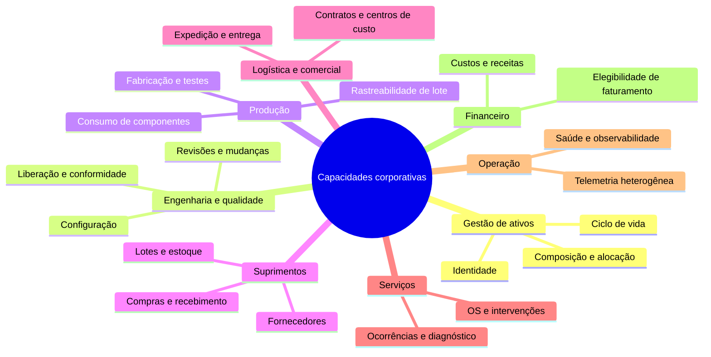

# 02 — Mapa de capacidades corporativas

[← Casos de uso](casos-de-uso.md) · [↑ Índice](../README.md) · [Domínios →](dominios.md)

Uma **capacidade** é uma aptidão estável da empresa; não é sistema, departamento nem processo.

## Catálogo inicial

| ID | Capacidade | Entrega principal | UCs |
|---|---|---|---|
| CAP-001 | Identificação de ativos | Identidade corporativa imutável + correspondências | 001–008 |
| CAP-002 | Ciclo de vida | Histórico de fabricação à retirada | 001–007 |
| CAP-003 | Alocação e hierarquias | Cliente, unidade, contrato e centro de custo temporais | 002–004, 007 |
| CAP-004 | Configuração técnica | As-designed, as-built, as-maintained | 001, 005–007, 008 |
| CAP-005 | Rastreabilidade de materiais | Fornecedor, lote, recebimento, consumo e equipamento | 001, 005, 006, 008 |
| CAP-006 | Processos de serviços | Ocorrências, OS, ações e validações | 003, 005–007 |
| CAP-007 | Gestão logística | Expedição, recebimento, devolução, movimentação | 002–004, 008 |
| CAP-008 | Monitoramento operacional | Saúde, indicadores e telemetria de produto | 003, 005–007 |
| CAP-009 | Elegibilidade e apuração financeira | Condições contratuais, custos e faturamento | 002–004, 006, 008 |
| CAP-010 | Processos e integrações | Comunicação confiável de fatos entre sistemas | 001–008 |
| CAP-011 | Governança de informações | Donos, regras, qualidade, segurança, auditabilidade | 001–008 |

**Observação:** o intervalo UC-001–UC-008 é inclusivo; o vínculo é referência conceitual, não matriz de dependências de código.

## Por que CAP-001 é corporativa?

Quando um dispositivo é fabricado, registrado no OTA, monitorado no GBQ e atendido em campo, todos os registros devem apontar para a mesma identidade, ainda que cada sistema tenha sua própria chave. Sem esta capacidade, qualquer dashboard 360° depende de conciliações frágeis.

**Critério de conclusão da etapa:** capacidade sem duplicidade de significado, dono preliminar, UCs atendidos e fronteira com capacidades vizinhas.
