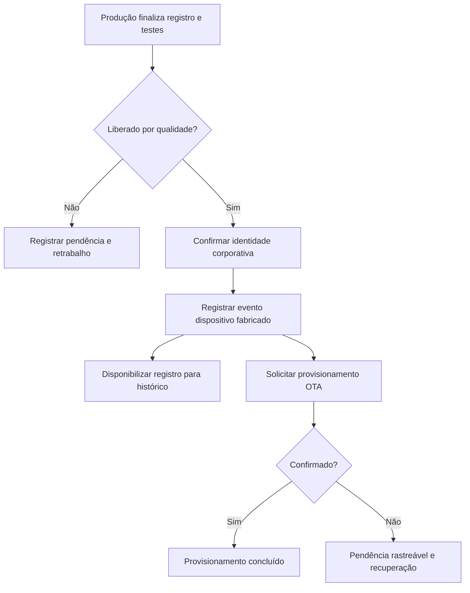
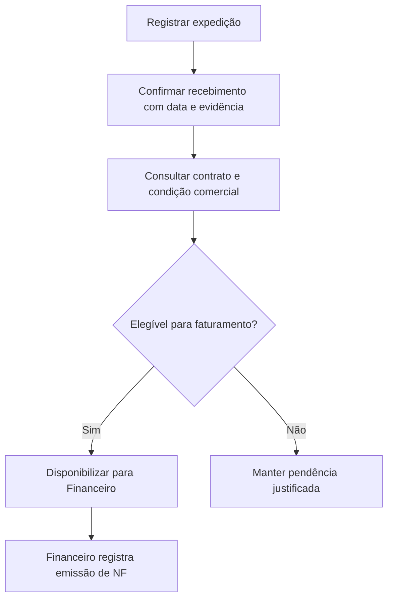
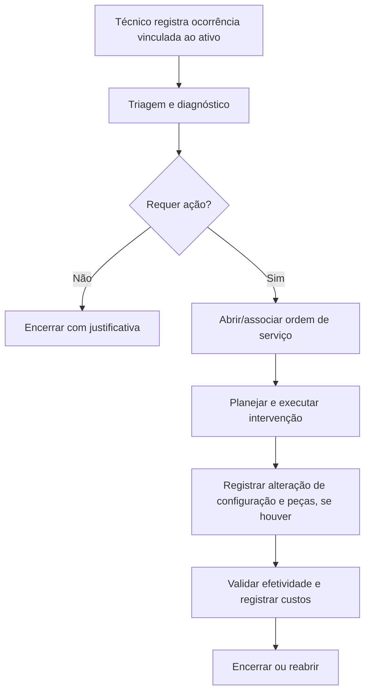
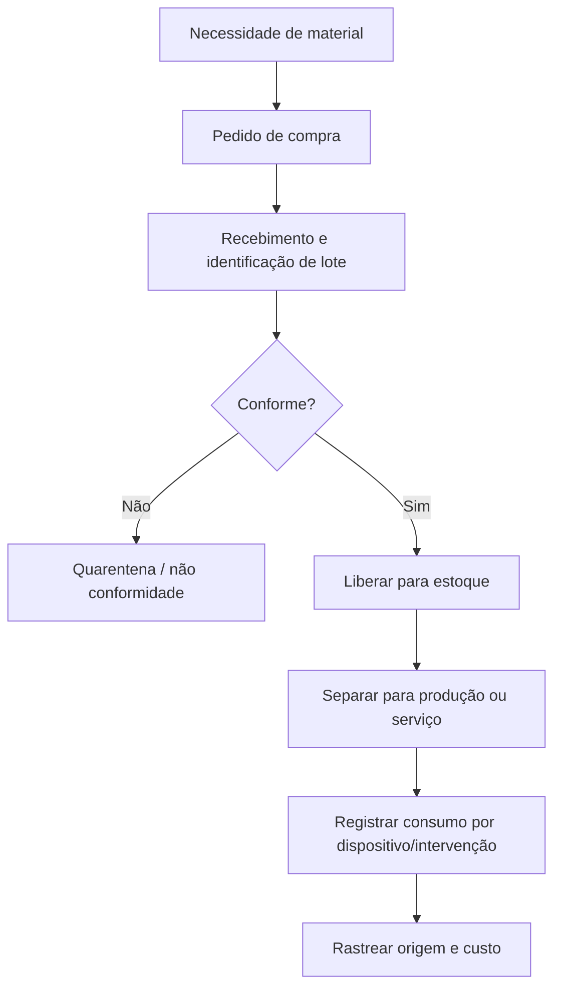

# 04 — Processos e regras de negócio

[← Domínios](dominios.md) · [↑ Índice](../README.md) · [Entidades →](../02-informacao/modelo-conceitual.md)

Processos são descritos **sem ferramenta ou mecanismo técnico**. Os diagramas representam o fluxo esperado, não uma automação já existente.

## PROC-001 — Fabricação e registro

Ver [E01](../exemplos/E01-registro-producao.md).

## PROC-002 — Expedição, recebimento e faturamento

Ver [E02](../exemplos/E02-entrega-faturamento.md).

## PROC-003 — Ocorrências e serviços

Ver [E06](../exemplos/E06-ocorrencias-os.md).

## PROC-004 — Suprimentos até consumo

Ver [E08](../exemplos/E08-suprimentos-rastreabilidade.md).

## Catálogo inicial de regras

| Regra | Enunciado |
|---|---|
| RN-001 | Nenhum dispositivo físico pode receber duas identidades corporativas ativas. |
| RN-002 | Números de série, MAC, IDs de Jira e OTA são identificadores externos; não substituem a identidade corporativa. |
| RN-003 | Dispositivo fabricado e provisionamento OTA são situações distintas; falha de OTA gera pendência, não novo dispositivo. |
| RN-004 | Recebimento requer evento datado, origem/responsável e evidência apropriada. |
| RN-005 | Elegibilidade para NF depende de condição contratual definida e validada; entrega não implica cobrança universalmente. |
| RN-006 | Cada alocação possui início, fim opcional e histórico; alterações não apagam alocações anteriores. |
| RN-007 | Configuração experimental exige autorização, objetivo, vigência, referência e possibilidade de identificar os dispositivos afetados. |
| RN-008 | Ocorrência, diagnóstico, OS, intervenção e validação são entidades distintas; permitem relações N:N onde necessário. |
| RN-009 | Estado operacional, logístico, financeiro, de qualidade e de comunicação não são um único status. |
| RN-010 | Sem comunicação não prova defeito: distinguir indisponível, desconhecido e não aplicável. |
| RN-011 | Consumo de componente vincula lote/serial, dispositivo ou OS, quantidade, momento e responsável. |
| RN-012 | Material sob não conformidade não pode ser tratado como liberado. |
| RN-013 | Eventos têm momento real, momento de registro e origem; atraso de conectividade é suportado. |
| RN-014 | Processos entre sistemas precisam indicar sucesso parcial, repetição segura, reconciliação e pendências. |

**Decisões em aberto:** regras fiscais por contrato, autoridade de confirmação de entrega, política de série/lote para componentes e fluxos de aprovação de modificações.
