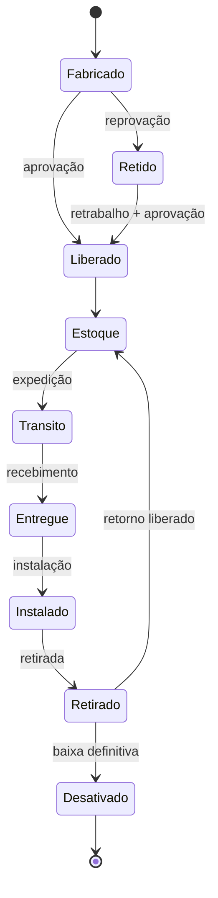

# 06 — Eventos, estados e ciclos de vida

[← Entidades](modelo-conceitual.md) · [↑ Índice](../README.md) · [Modelo lógico →](modelo-logico.md)

## Eventos corporativos iniciais

| ID | Evento | Origem responsável | Impacto potencial |
|---|---|---|---|
| EVT-001 | Dispositivo fabricado | Produção | Identidade e histórico |
| EVT-002 | Dispositivo liberado | Qualidade | Elegibilidade logística |
| EVT-003 | Dispositivo expedido | Logística | Em trânsito |
| EVT-004 | Recebimento pelo cliente confirmado | Logística/Serviços (validar) | Elegibilidade financeira |
| EVT-005 | Alocação alterada | Gestão de ativos | Cliente/centro de custo vigentes |
| EVT-006 | Modificação aplicada | Serviços | Configuração atual |
| EVT-007 | Ocorrência registrada | Serviços | Investigação |
| EVT-008 | Intervenção concluída | Serviços | Configuração, custo e validação |
| EVT-009 | Anomalia operacional detectada | Operação | Triagem |
| EVT-010 | Faturamento registrado | Financeiro | Estado financeiro |
| EVT-011 | Material recebido | Suprimentos | Lote recebido |
| EVT-012 | Material liberado ou bloqueado | Qualidade | Disponibilidade para consumo |
| EVT-013 | Material consumido | Produção/Serviços | Rastreabilidade e custo |
| EVT-014 | Provisionamento OTA confirmado | Operação | Dispositivo apto ao mecanismo OTA |

## Estados não devem ser fundidos

Exemplo simultâneo de DEV-00284:

| Dimensão | Estado ilustrativo |
|---|---|
| Logística | Instalado |
| Operação | Inoperante |
| Comunicação | Sem comunicação recente |
| Financeiro | Faturado |
| Serviço | OS aberta |
| Configuração | Experimental |
| Qualidade | Liberado com restrição |

**Cuidado:** este é um ciclo **logístico simplificado**. Operação, comunicação, qualidade, faturamento e configuração possuem máquinas de estado próprias e concorrentes.

## Temporalidade

Cada fato relevante deve distinguir:
- **event_time:** momento em que realmente ocorreu (ex.: intervenção às 14:10).
- **recorded_at:** momento em que o sistema tomou conhecimento (ex.: às 18:00, após reconexão).
- **valid_from / valid_until:** vigência de relação ou configuração.
- **source:** sistema/ator e referência ao registro que fundamenta o fato.
- **version:** versão do contrato/esquema ou regra.

Pergunta de validação: **qual cliente, centro de custo, revisão de hardware, firmware, modelo ML e composição física estavam associados ao dispositivo quando a anomalia ocorreu?**

Respostas devem utilizar o histórico, não apenas os atributos atuais.
