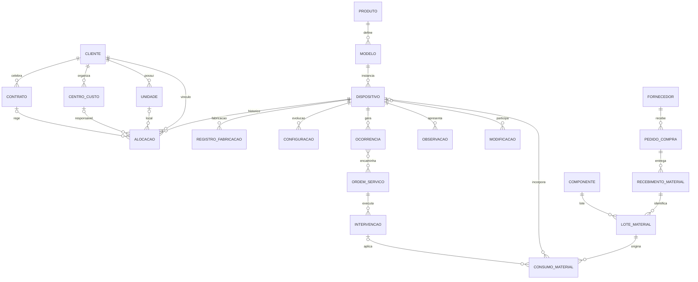

# 05 — Modelo conceitual corporativo

[← Processos](../01-negocio/processos-regras.md) · [↑ Índice](../README.md) · [Eventos →](eventos-estados.md)

## Identidade e relações

> **Relações propostas, não esquema definitivo.** Alguns vínculos exigirão entidades associativas e restrições de unicidade/temporalidade no modelo lógico. Por exemplo, um Gancho é composto por elementos físicos (central e dois ganchos) que podem ser trocados: introduzir **Composição de ativo** com início e fim de vigência, sem congelar a composição original.

## Classes de informação

| Classe | Exemplos | Por que separar |
|---|---|---|
| Entidade | Dispositivo, Cliente, Contrato, Componente, Fornecedor | Representa algo identificável |
| Relação temporal | Alocação, composição física, instalação de versão | Rastreia histórico, não atributo fixo |
| Evento | Fabricado, entregue, modificado, componente consumido | Preserva fato ocorrido |
| Estado derivado | Operacional, entregue, faturado, experimental | Mostra condição em um instante |
| Processo | Fabricação, OS, compra, faturamento | Controla ações e responsabilidades |
| Observação | Bateria, RSSI, IR, modelo ML, telemetria | Preserva granularidade específica |

## Identificadores e composição

- **ID corporativo** imutável por ativo físico.
- **Correspondências externas**: (sistema, tipo de ID, valor, período, ID corporativo). MACs podem mudar; não são chaves-mestre.
- **Composição temporal**: central e ganchos podem ser associados, substituídos ou reutilizados; consultar composição no momento da falha.
- **Hardware projetado, fabricado e mantido** são perspectivas distintas: *as-designed*, *as-built* e *as-maintained*.
- **Produto novo** adiciona extensões de domínio, sem forçar suas medições a campos do Gancho.

## Entidades propostas por assunto

| Assunto | Entidades principais |
|---|---|
| Clientes | Cliente, Unidade, Centro de custo, Contrato, Alocação |
| Ativos | Produto, Modelo, Dispositivo, Composição, Configuração |
| Engenharia | Revisão, Firmware, Modelo ML, Modificação, Campanha experimental |
| Produção | Ordem de fabricação, Registro de teste, Lote, Liberação |
| Suprimentos | Fornecedor, Item/Componente, Pedido, Recebimento, Lote, Estoque, Consumo |
| Serviços | Ocorrência, Diagnóstico, OS, Intervenção, Validação |
| Operação | Observação, Indicador, Evento operacional, Estado de comunicação |
| Financeiro | Condição de faturamento, Elegibilidade, NF, Custo |

[Veja atributos candidatos](modelo-logico.md) e [fluxos reais](../README.md#navegação-por-problema-real).
