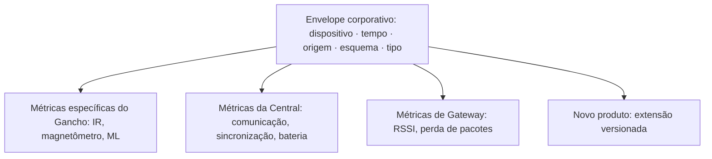

# 07 — Modelo lógico e dicionário inicial

[← Eventos](eventos-estados.md) · [↑ Índice](../README.md) · [Governança →](governanca.md)

**Não é DDL nem projeto de tabelas.** Define campos de negócio e restrições mínimas independentes de SGBD.

## Entidades fundamentais

### Dispositivo

| Campo | Tipo lógico | Regra |
|---|---|---|
| device_id | Identificador | Imutável, não reutilizado |
| serial_number | Texto | Unicidade no escopo definido por produto/fabricante |
| model_id | Referência | Obrigatória |
| manufacturing_at | Data/hora | Preservar origem |
| batch_id | Referência | Quando aplicável |
| lifecycle_status | Estado | Derivado conforme eventos e regras |
| created_at | Data/hora | Auditoria |

### Alocação

| Campo | Tipo lógico | Regra |
|---|---|---|
| allocation_id | Identificador | Único |
| device_id | Referência | Obrigatória |
| customer_id | Referência | Obrigatória |
| unit_id | Referência | Opcional/conforme operação |
| cost_center_id | Referência | Opcional/conforme contrato |
| contract_id | Referência | Opcional/conforme contrato |
| valid_from / valid_until | Intervalo temporal | Sem sobrescrever histórico |
| source_ref | Referência externa | Origem verificável |

**Invariante proposta:** não permitir alocações principais incompatíveis com vigências sobrepostas; exigir decisão de negócio se alocações compartilhadas forem permitidas.

### Configuração e modificação

| Campo | Tipo lógico | Regra |
|---|---|---|
| configuration_id | Identificador | Único |
| device_id | Referência | Obrigatória |
| hardware_revision | Versão | Fabricada/instalada, conforme perspectiva |
| firmware_version | Versão | Distinguir aprovada, provisionada e reportada |
| ml_model_version | Versão | Distinguir alvo de real |
| modification_id | Referência | Aplicação e reversão rastreadas |
| valid_from / valid_until | Intervalo | Reconstrução histórica |
| authorization_ref | Referência | Evidência de aprovação |

### Ocorrência, OS e intervenção

| Campo | Tipo lógico | Regra |
|---|---|---|
| occurrence_id | Identificador | Referência a ativo(s) e fato observado |
| work_order_id | Identificador | Pode reunir ocorrências |
| intervention_id | Identificador | Referência à OS e executor |
| observed_at | Data/hora | Momento em campo |
| executed_at | Data/hora | Momento da ação |
| action_type | Categoria | Padronizada, extensível |
| outcome | Resultado | Validado ou pendente |
| consumed_material_ref | Referência | Quando houver |
| evidence_ref | Referência | Fotos, diagnóstico, anotações |

### Suprimentos e materiais

| Campo | Tipo lógico | Regra |
|---|---|---|
| supplier_id | Identificador | Fornecedor corporativo |
| component_id | Referência | Código técnico e revisão |
| purchase_order_id | Identificador | Pedido de compra |
| supplier_batch | Texto | Lote do fornecedor, quando disponível |
| internal_lot_id | Identificador | Lote interno, quando aplicável |
| receipt_id | Identificador | Data, quantidade, origem e inspeção |
| disposition | Enumeração | Quarentena, aprovado, rejeitado etc. |
| consumption_id | Identificador | Vínculo a fabricação/dispositivo/OS |
| quantity / unit | Quantidade | Unidade definida |

### Observação operacional

| Campo | Tipo lógico | Regra |
|---|---|---|
| observation_id | Identificador ou referência | Rastreável à origem |
| device_id | Referência | Identidade corporativa |
| observed_at | Data/hora | Data real do dado |
| ingested_at | Data/hora | Data de recebimento |
| observation_type | Categoria | Extensível por produto |
| source_system / source_ref | Referência | Origem |
| schema_version | Versão | Compatibilidade |
| payload_ref | Referência | Registro detalhado, não força cópia integral |

## Núcleo comum e extensões

Não confundir telemetria bruta com indicadores corporativos. Indicadores requerem **definição, denominador, janela temporal, aplicabilidade, fonte, versão de cálculo e tratamento de ausências**. O mesmo conceito vale para custos e estoque.

**Pendências:** dicionário efetivo das tabelas atuais, critérios de unicidade de serial e composição, categorias de falhas, unidade financeira e granularidade de material.
