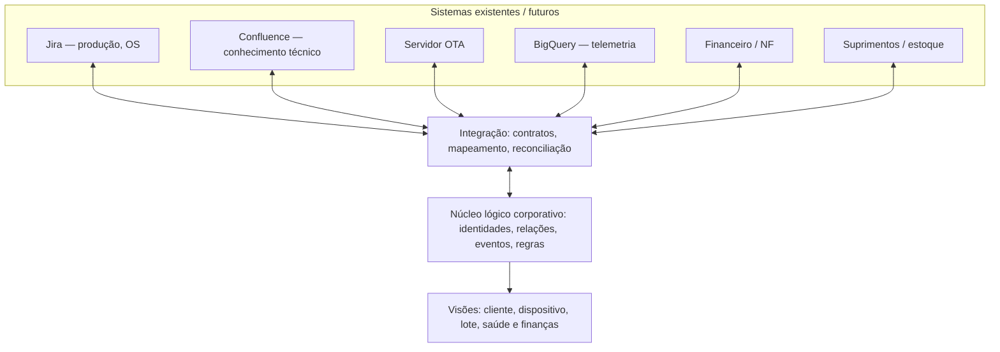
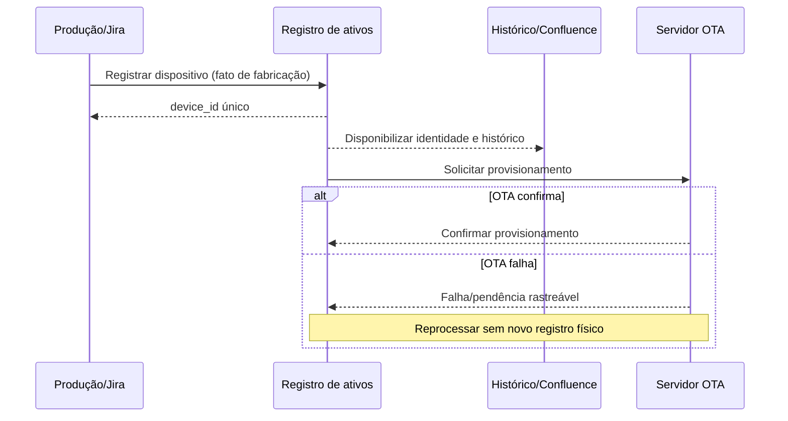
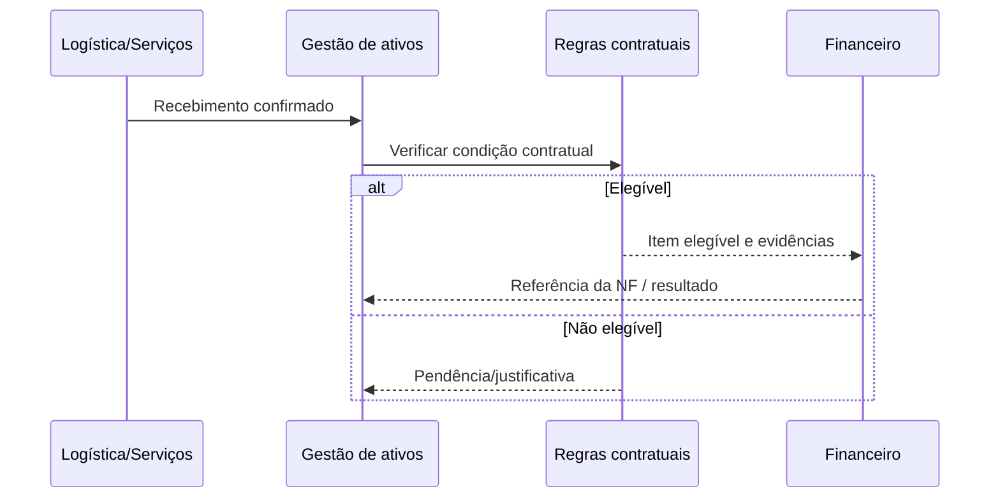
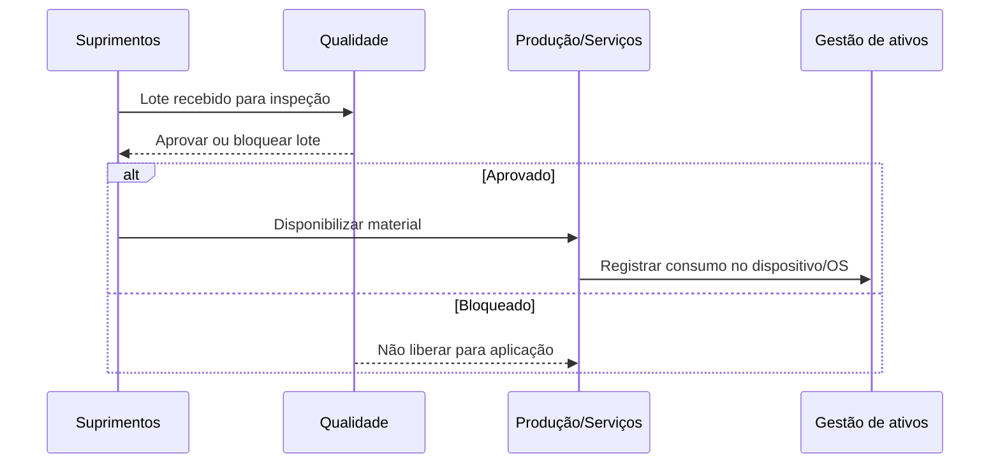

# 10 — Contratos e fluxos entre sistemas

[← Serviços](servicos.md) · [↑ Índice](../README.md) · [Visões →](visoes-gerenciais.md)

**Limite documental acordado:** definimos **quem troca o quê, por quê, quando, com qual garantia e responsabilidade**. Não escolhemos API, broker, ETL, protocolo nem banco.

## Visão de integração

**As setas são conceituais:** cada fluxo requer direção e autoridade próprias. Não significa acesso livre a todos os sistemas.

## Contratos candidatos

| ID | Fato/comando de negócio | Produtor autorizado | Consumidores candidatos | Condição crítica |
|---|---|---|---|---|
| CT-001 | Dispositivo registrado | Registro de ativos / Produção | Histórico, OTA, consultas | Unicidade e repetição segura |
| CT-002 | Provisionamento OTA concluído/falho | Servidor OTA | Gestão de ativos, produção | Não duplicar dispositivo |
| CT-003 | Expedição/recebimento confirmado | Logística | Gestão de ativos, Financeiro | Evidência e data efetiva |
| CT-004 | Elegibilidade calculada | Serviço financeiro/contratual | Financeiro, gestão | Regras por contrato |
| CT-005 | Alocação criada/encerrada | Gestão de ativos | Visões, Serviços, Financeiro | Temporalidade e referência |
| CT-006 | Modificação aprovada/aplicada/revertida | Engenharia / Serviços conforme fato | Ativos, operação, engenharia | Autorização x execução |
| CT-007 | Ocorrência/OS/intervenção | Serviços | Engenharia, ativos, Financeiro | Sequência de estados |
| CT-008 | Observação ou indicador operacional | Operação | Visões, Serviços | Esquema específico por produto |
| CT-009 | Lote recebido/liberado | Suprimentos / Qualidade | Produção, Serviços | Bloqueio de lote |
| CT-010 | Material consumido | Produção / Serviços | Suprimentos, ativos, Financeiro | Origem, destino, quantidade |

### Modelo mínimo de contrato

| Dimensão | Definição obrigatória |
|---|---|
| Identidade | contract_id, event_id, entity_id, external_refs |
| Semântica | Tipo, objetivo, pré-condições e campos obrigatórios |
| Responsabilidade | Dono de negócio, produtor e consumidor |
| Temporalidade | event_time, recorded_at, validade |
| Esquema | Versão, compatibilidade, políticas de mudança |
| Confiabilidade | Idempotência, erro parcial, pendência, replay e reconciliação |
| Segurança | Autorização, finalidade, informação sensível |
| Qualidade | Critérios de aceitação, consistência, proveniência |

## Sequência: produção, histórico e OTA

**Nota:** a participação do Confluence é opcional: seu papel pode ser somente documentação e link a um histórico dinâmico, evitando duplicação.

## Sequência: logística e financeiro

## Sequência: componente comprado e aplicado

## O que não está definido

- Interface/protocolo, horários de processamento, SLAs e volumes.
- Sistemas substituídos, novos produtos de software e hospedagem.
- Regras fiscais específicas e contrato concreto de cada cliente.
- Estratégia física do armazenamento e da migração.

Tudo isso depende das validações e pertence à especificação posterior.
