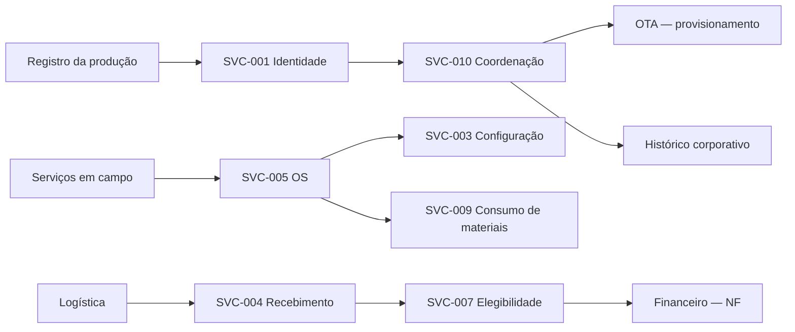

# 09 — Serviços funcionais corporativos

[← Governança](../02-informacao/governanca.md) · [↑ Índice](../README.md) · [Contratos →](contratos-fluxos.md)

**Serviço funcional** é uma capacidade disponibilizada e governada. Não implica microsserviço, aplicação ou banco separados.

| ID | Serviço | Responsabilidade | Casos de uso |
|---|---|---|---|
| SVC-001 | Registro e identidade de ativos | Criar identidade, validar série, mapear IDs externos | UC-001–008 |
| SVC-002 | Gestão de alocações | Vincular cliente, unidade, contrato e centro de custo com história | UC-002–004, 007 |
| SVC-003 | Gestão de configuração | Revisões, firmware, ML e modificações reais/aprovadas | UC-001, 005–007 |
| SVC-004 | Gestão logística | Expedição, recebimento, devolução e rastreio | UC-002–004 |
| SVC-005 | Gestão de serviços | Ocorrência, diagnóstico, OS, intervenção e validação | UC-005–007 |
| SVC-006 | Monitoramento operacional | Indicadores, observações e contexto da telemetria | UC-003, 007 |
| SVC-007 | Elegibilidade financeira | Regras por contrato e situação de faturamento | UC-002, 003 |
| SVC-008 | Consulta corporativa | Visões por cliente, ativo, lote, projeto e período | UC-003–008 |
| SVC-009 | Gestão de materiais e suprimentos | Fornecedor, compra, recebimento, lote, estoque e consumo | UC-001, 006, 008 |
| SVC-010 | Coordenação e reconciliação | Acompanhar efeitos intersistemas e exceções | UC-001–008 |

## Limites e composição

### Exemplo de responsabilidade de SVC-001

- Registrar novo ativo físico a partir de um evento de fabricação validado.
- Verificar unicidade conforme política de série/modelo.
- Emitir identidade corporativa.
- Relacionar IDs Jira, OTA, MAC/identificadores de telemetria.
- Permitir consulta por identidade ou por correspondência externa.
- Controlar estado de cadastro e rastrear origem.

**Não cabe ao SVC-001:** definir regra fiscal, armazenar telemetria bruta, aprovar modificação ou emitir NF.

## Critérios

Cada serviço deve possuir dono de negócio, operações funcionais, entradas, saídas, regras, precondições, estados de erro, expectativas de qualidade e rastreabilidade até UC/CAP/ENT/EVT.

[Veja os contratos de integração](contratos-fluxos.md).
