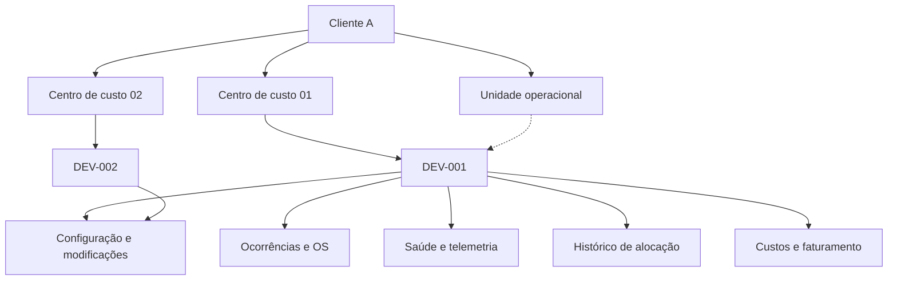

# Visões gerenciais e navegação TOP-DOWN (referência funcional)

[↑ Índice](../README.md) · [Contratos](contratos-fluxos.md) · [Exemplo Cliente 360°](../exemplos/E03-cliente-top-down.md)

Este documento ilustra o **consumo esperado**, sem propor UI final nem iniciar a etapa tecnológica.

**Importante:** centro de custo (responsabilidade econômica), unidade (local físico), contrato (relação comercial) e cliente são **dimensões independentes**, não uma árvore hierárquica obrigatória.

### Exemplos fictícios de indicadores

| Nível | Indicador | Regra necessária |
|---|---|---|
| Cliente | Parque instalado | Contar dispositivos com alocação e estado logístico elegíveis na data de referência |
| Centro de custo | Equipamentos atribuídos | Contar alocações vigentes, não cadastros históricos |
| Produto | Disponibilidade | Definir janela e regra específica de produto |
| Dispositivo | Última comunicação | Maior event_time de comunicação válida; atraso identificado |
| Dispositivo | Modificações em teste | Aplicações experimentais vigentes |
| Serviço | OS abertas | Status de OS, não ocorrência simples |
| Financeiro | Itens elegíveis para NF | Critérios contratuais configurados |
| Suprimentos | Lotes sob bloqueio | Disposição de qualidade atual |

### Navegação inversa

Também deve ser possível consultar: **lote de componente → dispositivos montados → clientes atuais/históricos → ocorrências e intervenções**; ou **anomalia → dispositivo → firmware/ML na data → revisão e lote → cliente e OS**.

### Cuidados de interpretação

- Não usar soma de estados mutuamente incompatíveis.
- Manter **não aplicável**, **sem dados** e **falha comprovada** separados.
- Preservar granularidade: Gancho/central/gateway podem ter semânticas distintas.
- Respeitar segregação por cliente e restrição financeira.
- Exibir período e proveniência de cada indicador.
