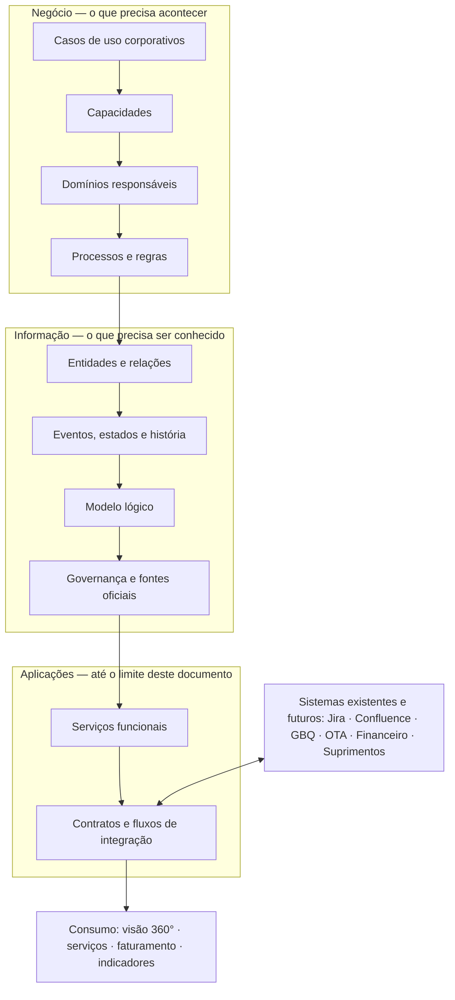

# Arquitetura corporativa de integração

> **Proposta para aprovação executiva — versão 0.1 (25/11/2026).** Esta documentação é uma **arquitetura de referência proposta**, não uma solução implantada. Exemplos de identificadores, estados, métricas e estruturas são ilustrativos. Fontes oficiais, responsabilidades e regras contratuais ainda exigem validação.

## Visão executiva

**Problema:** os registros de produção, operação, serviços, logística, suprimentos e financeiro estão distribuídos em sistemas como Jira, Confluence, BigQuery e servidor OTA. A fragmentação obriga registros manuais repetidos, dificulta o faturamento e impede rastrear um equipamento da fabricação até sua operação e manutenção.

**Decisão proposta:** unificar a **identidade, o significado, os relacionamentos, os eventos e os processos** da empresa, sem obrigar a substituir os sistemas especializados nem centralizar fisicamente todos os dados.

**Resultados esperados**
1. Registrar um dispositivo uma única vez e acionar processos dependentes (Jira, histórico do produto, OTA).
2. Identificar quais equipamentos foram expedidos, recebidos, instalados e estão elegíveis para faturamento.
3. Navegar de cliente → centro de custo/unidade → equipamento → configuração, intervenções e telemetria.
4. Preservar histórico de lotes, componentes, revisões, modificações experimentais e realocações.
5. Registrar ocorrências, diagnósticos, OS e intervenções, relacionando custos e efeitos.
6. Adicionar produtos com telemetria distinta e novas áreas, como Suprimentos, sem reestruturar o núcleo corporativo.

### Visão arquitetural

> **Escopo:** detalhamento TOP-DOWN até a definição conceitual dos serviços e contratos de integração. Protocolos, banco físico, nuvem, desenvolvimento de APIs e implantação pertencem à etapa técnica posterior.

## Navegação TOP-DOWN

| Etapa | Pergunta respondida | Documento |
|---|---|---|
| 01 — Casos de uso | Que problemas resolver? | [Casos de uso e critérios de aceitação](01-negocio/casos-de-uso.md) |
| 02 — Capacidades | O que precisamos ser capazes de fazer? | [Mapa de capacidades](01-negocio/capacidades.md) |
| 03 — Domínios | Quem responde por cada informação e decisão? | [Domínios e responsabilidades](01-negocio/dominios.md) |
| 04 — Processos | Como a empresa opera e quais regras se aplicam? | [Processos e regras](01-negocio/processos-regras.md) |
| 05 — Entidades | O que existe e se relaciona? | [Modelo conceitual](02-informacao/modelo-conceitual.md) |
| 06 — Eventos e estados | O que aconteceu e como estava? | [Ciclos de vida e eventos](02-informacao/eventos-estados.md) |
| 07 — Modelo lógico | Que informação mínima cada entidade contém? | [Dicionário lógico](02-informacao/modelo-logico.md) |
| 08 — Governança | Qual é a fonte oficial, quem é responsável? | [Fontes oficiais e governança](02-informacao/governanca.md) |
| 09 — Serviços | Quais funções corporativas são compartilhadas? | [Catálogo de serviços](03-integracao/servicos.md) |
| 10 — Integrações | Que informação cada sistema entrega e consome? | [Contratos e fluxos](03-integracao/contratos-fluxos.md) |

A **etapa 11 (interfaces e indicadores)** aparece apenas como visão conceitual para validar a navegação: [visões gerenciais](03-integracao/visoes-gerenciais.md). **A etapa 12 (tecnologia/implantação) não está especificada.**

## Navegação por problema real

| Dificuldade observada | Percurso documentado |
|---|---|
| Produção cadastrada no Jira, Confluence e OTA separadamente | [E01 — Fabricação e provisionamento](exemplos/E01-registro-producao.md) |
| Financeiro não sabe quais itens chegaram ao cliente | [E02 — Recebimento e faturamento](exemplos/E02-entrega-faturamento.md) |
| Impossibilidade de análise TOP-DOWN por cliente | [E03 — Cliente 360°](exemplos/E03-cliente-top-down.md) |
| Um cliente tem vários centros de custo | [E04 — Alocação histórica](exemplos/E04-alocacao-centro-custo.md) |
| Equipamentos em teste possuem modificações individuais | [E05 — Configuração experimental](exemplos/E05-modificacoes-campo.md) |
| Técnicos registram ocorrências e precisam de OS | [E06 — Serviços e intervenções](exemplos/E06-ocorrencias-os.md) |
| Telemetrias diferentes precisam compor uma visão única | [E07 — Saúde e telemetria](exemplos/E07-saude-telemetria.md) |
| Compras e componentes precisam ser rastreados até a fabricação | [E08 — Suprimentos e lotes](exemplos/E08-suprimentos-rastreabilidade.md) |

## Documentos para a decisão do CEO

- [Proposta executiva e critérios de aprovação](governanca/proposta-executiva.md)
- [Princípios, pressupostos e riscos](governanca/principios-riscos.md)
- [Expansão para novos domínios ou produtos](governanca/expansao.md)
- [Matriz de rastreabilidade](governanca/rastreabilidade.md)
- [Etapas, gates e decisões pendentes](governanca/roadmap-aprovacao.md)

## Diretrizes obrigatórias

**Registrar uma vez, usar várias; separar sistemas de suas responsabilidades; preservar histórico; distinguir identidade, evento, estado e processo; modelar núcleo comum com extensões por produto; não confundir ausência de comunicação com falha comprovada; restringir acesso por domínio e finalidade; garantir reconciliação e reprocessamento de integrações.**

As integrações são **bidirecionais conforme responsabilidades**, não significam que qualquer sistema possa modificar qualquer dado. Ver [governança](02-informacao/governanca.md).

**Fora do escopo inicial:** RH, gestão de competências e carreira; desenho físico de banco; escolha de ferramentas e protocolos; implementação; migração detalhada. A inclusão futura de RH é tratada em [expansão](governanca/expansao.md).
