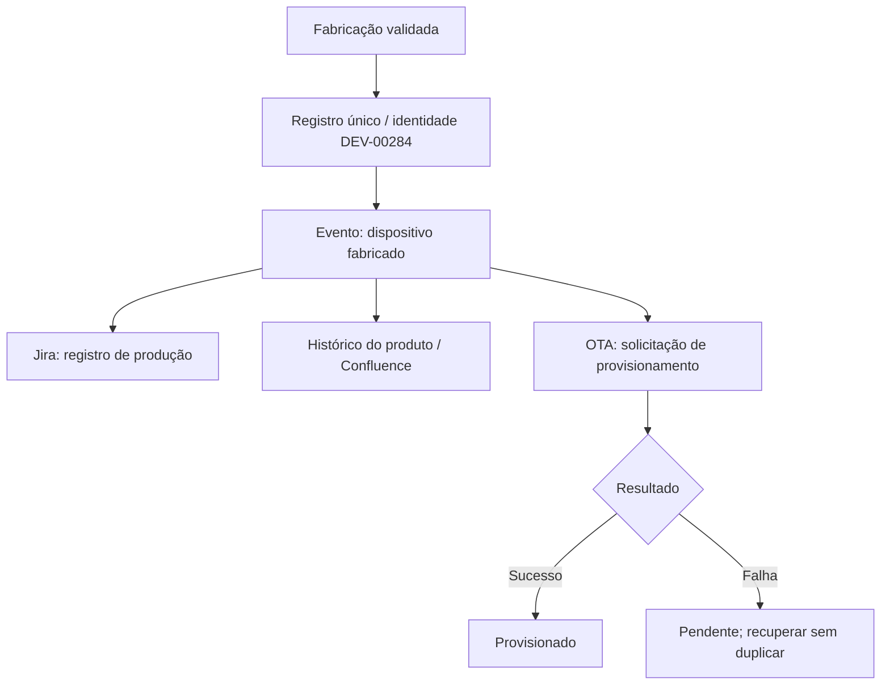

# E01 — Registro único de produção e provisionamento

[↑ Índice](../README.md) · [UC-001](../01-negocio/casos-de-uso.md) · [SVC-001](../03-integracao/servicos.md) · [CT-001/002](../03-integracao/contratos-fluxos.md)

## Dor atual

Um dispositivo produzido é cadastrado em **Jira**, depois recebe um documento de vida no **Confluence**, e é cadastrado manualmente no **servidor OTA**. Três ações para o mesmo ativo, com risco de divergências.

## Resultado de negócio

O operador registra a fabricação **uma vez**. O ativo recebe identidade corporativa; os consumidores são atualizados ou apresentam pendências. Confluence pode oferecer documento dinâmico ao invés de duplicar cadastro.

**O Jira pode permanecer como ponto de captura do registro**. O desenho não impõe um portal novo. O fluxo é lógico, não tecnologia selecionada.

## Exemplo fictício

| Campo | Valor |
|---|---|
| device_id | DEV-00284 |
| Serial de fabricação | SN-284 |
| ID Jira | PROD-184 |
| ID OTA | 284 |
| Estado de fabricação | Aprovado |
| Estado OTA | Pendente |
| Próxima ação | Reprocessar provisionamento |

## Cadeia TOP-DOWN

**UC-001 → CAP-001/002/010 → Produção + Ativos + Operação → PROC-001/RN-001/003/014 → Dispositivo e Registro de fabricação → EVT-001/014 → SVC-001/010 → CT-001/002 → Jira/Confluence/OTA.**

## Critérios de aceite

- Serial não pode criar dois IDs corporativos.
- Falha de OTA não apaga o registro de produção.
- Visualizar status e referências em todos os sistemas.
- Registrar quem criou o dispositivo e origem da fabricação.
