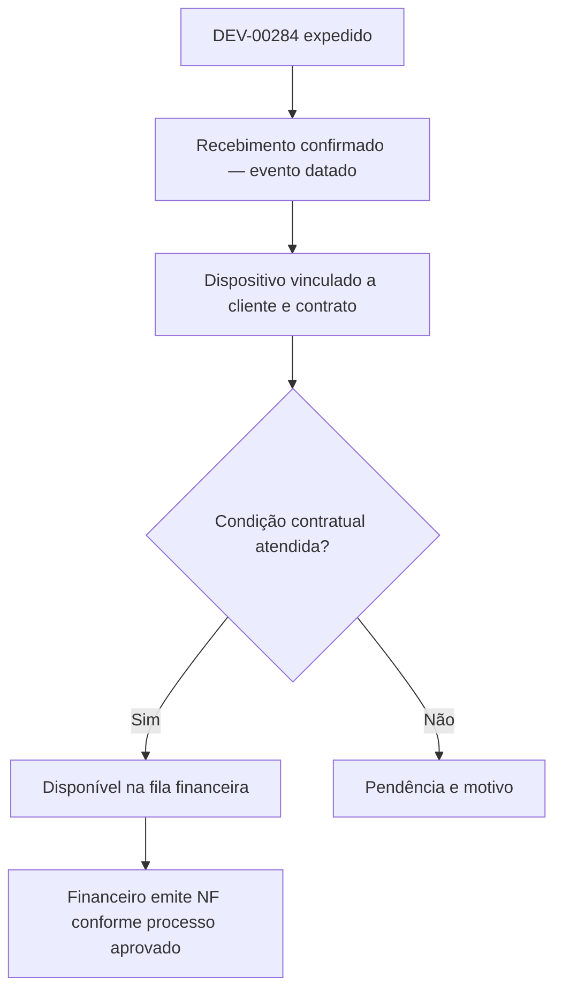

# E02 — Recebimento e elegibilidade para faturamento

[↑ Índice](../README.md) · [UC-002](../01-negocio/casos-de-uso.md) · [PROC-002](../01-negocio/processos-regras.md)

## Dor atual

Financeiro precisa perguntar a outras áreas quais equipamentos chegaram ao cliente, quando chegaram e se podem ser faturados.

## Proposta

## Exemplo fictício

| Item | Recebimento | Contrato | Elegibilidade | NF |
|---|---|---|---|---|
| DEV-001 | 10/11/2026 | CTR-A | Sim | Emitida |
| DEV-002 | 12/11/2026 | CTR-A | Sim | Pendente |
| DEV-003 | 14/11/2026 | CTR-B | Não — requer instalação | Não emitida |
| DEV-004 | Não confirmado | CTR-A | Não — sem entrega | Não emitida |

**Cuidado:** o evento de entrega não implica automaticamente emissão de nota. Critérios e tributos dependem da modalidade contratual e validação financeira.

## Cadeia

**UC-002 → CAP-007/009 → Logística, Comercial, Financeiro → PROC-002/RN-004/005 → Remessa/Recebimento/Contrato → EVT-003/004/010 → SVC-004/007 → CT-003/004 → sistemas logísticos e financeiros.**

## Aceite

Lista por cliente/contrato com evidência, momento de recebimento, razão de elegibilidade/pendência e referência da NF.
