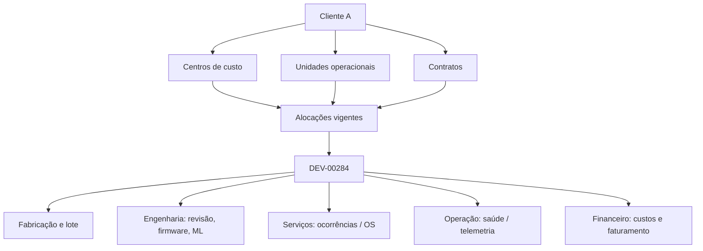

# E03 — Navegação cliente → dispositivo → informação

[↑ Índice](../README.md) · [UC-003](../01-negocio/casos-de-uso.md) · [Visões gerenciais](../03-integracao/visoes-gerenciais.md)

## Dor atual

Cada projeto possui tabelas e registros distintos. Não é possível partir do cliente e chegar, consistentemente, a equipamentos em campo, configuração, OS, custos e saúde.

## Ilustração — dados fictícios

Cliente A: 120 ativos alocados, 108 classificados operacionais e 12 sinalizados para avaliação **conforme definição de indicador ainda a validar**. CC-01: 70 equipamentos; CC-02: 30; CC-03: 20. São valores didáticos, não dados de produção.

**Centro de custo, unidade e contrato são filtros independentes.** Uma unidade pode conter ativos de diferentes centros de custo e um centro de custo pode ter ativos em várias unidades.

## Aceite

1. Selecionar cliente, período, produto, centro de custo e unidade.
2. Identificar equipamento por serial, MAC ou ID corporativo sem duplicá-lo.
3. Abrir histórico de instalação, configuração e serviço.
4. Aprofundar em telemetria original conforme o produto.
5. Reconstituir a mesma visão em data passada.

**Cadeia:** UC-003 → CAP-003/008 → Cliente/Alocação/Dispositivo/Observação → SVC-002/006/008 → CT-005/008.
