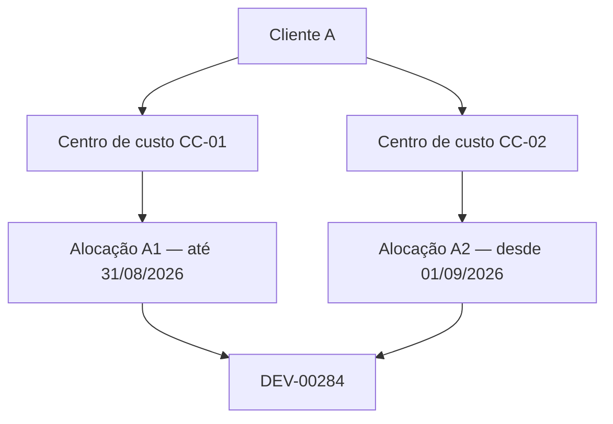

# E04 — Alocação e realocação por centro de custo

[↑ Índice](../README.md) · [UC-004](../01-negocio/casos-de-uso.md) · [Modelo lógico](../02-informacao/modelo-logico.md)

## Dor atual

Um cliente distribui equipamentos por múltiplos centros de custo. É necessário saber **qual dispositivo pertence a qual centro de custo e em que período**.

## Histórico fictício

| Dispositivo | Centro de custo | Vigência |
|---|---|---|
| DEV-00284 | CC-01 | 01/06/2026 a 31/08/2026 |
| DEV-00284 | CC-02 | desde 01/09/2026 |

**Não gravar o centro de custo apenas em um campo sobrescrito do dispositivo.** Registrar entidade de alocação com vigência e referências à unidade, contrato e cliente; diferenciar responsabilidade comercial, econômica e física.

## Aceite

- Consulta atual e histórica por equipamento e por centro de custo.
- Rastreamento de mudanças com justificativa e responsável.
- Conciliação financeira usando a alocação correta na data de interesse.

**Cadeia:** UC-004 → CAP-003 → Gestão de ativos + Comercial → RN-006 → Alocação → EVT-005 → SVC-002 → CT-005.
