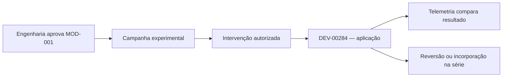

# E05 — Modificações experimentais em campo

[↑ Índice](../README.md) · [UC-005](../01-negocio/casos-de-uso.md) · [Configuração](../02-informacao/modelo-conceitual.md)

## Dor atual

Alguns equipamentos foram modificados para validar melhorias em campo. Precisamos localizar quais são, o que mudou, quem autorizou, quando foi aplicado e se a alteração foi revertida.

## Três perspectivas

- **As-designed:** especificação e versão aprovadas pela engenharia.
- **As-built:** o que realmente foi montado e testado em produção.
- **As-maintained:** o que foi alterado durante uso e intervenções.
- **Observado:** firmware/modelo efetivamente reportado pelo dispositivo, que pode divergir do desejado.

## Exemplo fictício

| Aspecto | Valor |
|---|---|
| Dispositivo | DEV-00284 |
| Revisão fabricada | HW v5 |
| Firmware instalado | FW v2.4.1 |
| Modelo ML reportado | ML v8 experimental |
| MOD-001 | Alteração de modelo de classificação |
| MOD-002 | Sensor IR substituído |
| Campanha | TEST-2026-03 |
| Estado | Experimental vigente |

## Consultas esperadas

Quais clientes usam dispositivos modificados? Quais tiveram falhas sob MOD-001? A revisão HW do lote influencia os resultados? Quais dispositivos exigem reversão?

**Cadeia:** UC-005 → CAP-004 → Engenharia + Serviços + Operação → RN-007 → Modificação/Configuração/Campanha → EVT-006/008 → SVC-003 → CT-006.
