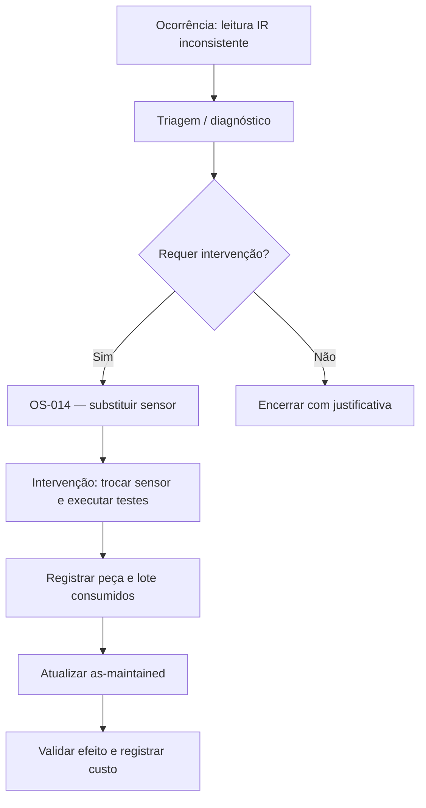

# E06 — Ocorrências, ordens de serviço e intervenções

[↑ Índice](../README.md) · [UC-006](../01-negocio/casos-de-uso.md) · [PROC-003](../01-negocio/processos-regras.md)

## Dor atual

Técnicos em campo devem lançar ocorrências relacionadas ao equipamento, permitindo diagnóstico e abertura de OS sem depender de conhecer a estrutura de Jira ou de tabelas.

## Exemplo fictício

| Registro | Valor |
|---|---|
| Dispositivo | DEV-00284 |
| Ocorrência | OCO-031 — distância IR inconsistente |
| Diagnóstico | Suspeita de falha do sensor frontal |
| OS | OS-014 |
| Intervenção | INT-022 — substituição de sensor |
| Material | LOTE-IR-26-04 |
| Validação | Testes pós-reparo — resultado anexado |
| Custo | Apropriação vinculada à intervenção |

**Uma ocorrência pode não gerar OS; uma OS pode tratar várias ocorrências; uma OS pode ter múltiplas intervenções.**

## Aceite

Registrar em campo com vínculo inequívoco ao dispositivo, momento de ocorrência, evidência, diagnóstico, ações, materiais e resultado. Consultar histórico por dispositivo, cliente, tipo de falha, revisão e lote.

**Cadeia:** UC-006 → CAP-006/005 → Serviços, Engenharia, Qualidade → RN-008/011 → Ocorrência/OS/Intervenção → EVT-007/008/013 → SVC-005/009 → CT-007/010.
