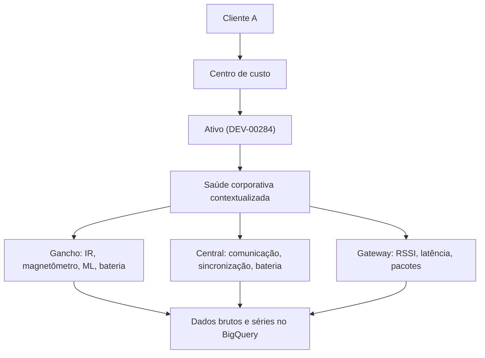

# E07 — Cliente → equipamento → saúde → telemetria original

[↑ Índice](../README.md) · [UC-007](../01-negocio/casos-de-uso.md) · [Visões](../03-integracao/visoes-gerenciais.md)

## Dor atual

Há produtos com estruturas de telemetria distintas no BigQuery. O gestor precisa começar no cliente e aprofundar até a métrica ou observação técnica sem conhecer tabelas específicas.

## Dois níveis de informação

| Nível | Padrão |
|---|---|
| Corporativo | Identidade, data, origem, disponibilidade/estado aplicável, último contato, qualidade |
| Produto | Campos técnicos próprios, esquemas versionados, métricas e diagnósticos específicos |

### Definições importantes

- **Disponibilidade:** exige janela, regra do produto, eventos observáveis e denominador.
- **Última comunicação:** não equivale a falha do dispositivo.
- **Não aplicável:** ex.: bateria para equipamento sem bateria.
- **Desconhecido:** sem observação suficiente para concluir saúde.
- **Versão ML ou FW:** distinguir configuração desejada, aprovada e reportada.
- **Coleta tardia:** preservar momento de ocorrência e momento de chegada.

## Aceite

Do cliente ao registro específico com referência original no BigQuery; comparação somente de métricas equivalentes e visão histórica coerente com a alocação da época.

**Cadeia:** UC-007 → CAP-008 → Operação/Engenharia → Observação/Indicador/Dispositivo/Alocação → EVT-009 → SVC-006/008 → CT-008.
