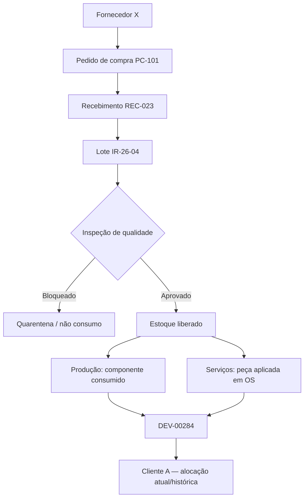

# E08 — Suprimentos: fornecedor → lote → equipamento → campo

[↑ Índice](../README.md) · [UC-008](../01-negocio/casos-de-uso.md) · [Processo de expansão](../governanca/expansao.md)

## Novo problema incorporado ao escopo

Uma compra de sensores ou PCBs precisa permanecer rastreável após recebimento, inspeção, fabricação e substituição em campo. Uma não conformidade de lote exige descobrir dispositivos e clientes afetados.

## Exemplo fictício

| Registro | Valor |
|---|---|
| Fornecedor | SUP-014 |
| Pedido | PC-101 |
| Lote do fornecedor | FAB-IR-44 |
| Lote interno | IR-26-04 |
| Inspeção | Liberado na data do recebimento |
| Consumo | Produção de DEV-00284 |
| Diagnóstico posterior | Possível falha associada ao lote |

A investigação pode percorrer o caminho inverso: **lote suspeito → consumos → equipamentos → clientes/unidades/centros de custo → ocorrências e OS**.

## Limites do modelo

- Componentes podem exigir rastreamento **por lote** ou **por unidade serializada**.
- Consumo em fabricação e consumo de peça em OS são eventos distintos.
- Não presumir que todos os componentes são críticos nem que todo material necessita serial individual.
- Custos de aquisição, estoque e serviço podem ser consumidos pelo financeiro sem duplicar sua fonte oficial.

## Cadeia TOP-DOWN

**UC-008 → CAP-005/010 → Suprimentos/Qualidade/Produção/Serviços → PROC-004/RN-011/012 → Fornecedor/Pedido/Recebimento/Lote/Consumo/Dispositivo → EVT-011/012/013 → SVC-009 → CT-009/010 → sistemas de compras/estoque e produção.**

## Aceite

Permitir identificar lote e fornecedor a partir de um equipamento e identificar equipamento/cliente a partir de um lote. Bloqueio de qualidade deve impedir que lote seja apresentado como liberado.
