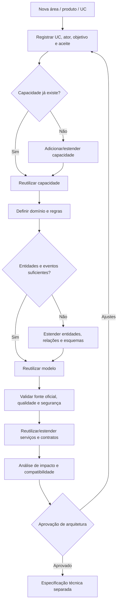

# Processo de expansão para novas áreas, produtos e casos de uso

[↑ Índice](../README.md) · [Capacidades](../01-negocio/capacidades.md) · [Modelo conceitual](../02-informacao/modelo-conceitual.md)

## Regra central

A arquitetura não é orientada exclusivamente a dispositivos. **Cliente, fornecedor, componente, contrato, projeto e dispositivo** podem ser eixos de entrada. Um domínio novo utiliza a mesma estrutura TOP-DOWN, sem precisar copiar os modelos dos demais.

## Procedimento operacional da mudança

| Passo | Artefato atualizado | Pergunta de controle |
|---|---|---|
| 1 | Catálogo de UCs | Qual problema e resultado mensurável? |
| 2 | Mapa de capacidades | Reutilizamos algo existente? |
| 3 | Mapa de domínios | Quem decide, executa e valida? |
| 4 | Processos e regras | Que evento desencadeia o trabalho? |
| 5 | Modelo conceitual | Quais objetos e relações surgem? |
| 6 | Eventos e ciclos | Como registrar e reconstruir o histórico? |
| 7 | Modelo lógico | Há campos e esquemas novos? |
| 8 | Governança | Quais fontes oficiais, acessos e políticas? |
| 9 | Serviços | Qual funcionalidade compartilhável? |
| 10 | Contratos | Quem produz e consome o fato? |
| 11 | Análise de impacto | O que muda e como manter compatibilidade? |

## Exemplo concreto: introdução de Suprimentos

**Problema:** fornecedor entrega lote de sensores IR; 3 dispositivos de determinado lote apresentam falha em campo. Precisamos identificar quais equipamentos incorporaram componentes daquele fornecimento, quem os recebeu e liberou, e quais clientes foram afetados.

- **UC-008:** rastrear compra → recebimento → inspeção → estoque → consumo → dispositivo → cliente.
- **CAP-005/CAP-009:** reaproveitar rastreabilidade de ativos e informações materiais; adicionar controle de fornecedor/lote/estoque.
- **DOM:** Suprimentos recebe, Qualidade libera, Produção ou Serviços registra consumo.
- **ENT:** Fornecedor, componente, pedido, recebimento, lote, consumo; reutilizar dispositivo, OS e cliente.
- **EVT:** material recebido, liberado/bloqueado, consumido.
- **SVC-009/CT-009/CT-010:** compartilhar fato de lote e utilização; sem obrigação de substituir eventual ERP.
- **Consulta:** lote → componentes → equipamentos → alocações vigentes e históricas → intervenções.

[Percurso detalhado E08](../exemplos/E08-suprimentos-rastreabilidade.md).

## Exemplo futuro: inclusão de RH (fora do escopo presente)

RH pode adicionar colaborador, competência, treinamento, qualificação e carreira; relacionar colaboradores a atividades, OS e projetos. A arquitetura **não exige que dispositivo seja entidade central**, apenas que relações e competências sejam governadas. Não cadastrar nem implementar RH agora.

## Exemplo futuro: novo produto com telemetria diferente

Um wearable com IMU e vibração não é obrigado a adotar campos do Gancho. Reutiliza identidade, cliente, alocação, histórico e observação corporativa; adiciona esquema versionado específico e declara como seus indicadores contribuem para métricas comuns.

**Regra de aprovação:** nenhuma expansão pode apagar significado de campos existentes, quebrar contratos publicados ou reescrever silenciosamente históricos. Registrar análise de impacto, compatibilidade, responsável e decisão arquitetural (ADR).
